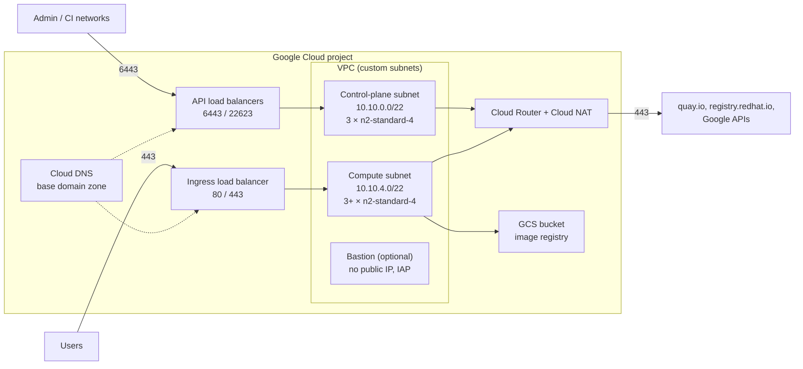
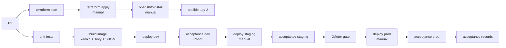

# Engineering document (document d'ingénierie)

| Item        | Value                                   |
|-------------|-----------------------------------------|
| Platform    | openshift-gcp-platform                  |
| Version     | 0.1.0                                   |
| Owner       | Platform / integration team             |
| Last update | 2026-11-11                              |

## 1. Purpose and scope

This platform installs, configures and operates an OpenShift Container Platform 4 cluster on
Google Cloud and delivers a reference workload (`subscriber-api`) onto it through a fully
automated chain: infrastructure as code, cluster installation, day-2 configuration,
application packaging, deployment, technical acceptance and documentation.

It is designed the way an integration team delivers a solution to an operating company:
every network flow is declared before it is opened, every environment is reproducible from
Git, every delivery ends with an acceptance record, and operations have a runbook.

Out of scope: application business logic (the API is intentionally minimal), multi-cluster
topologies, disconnected (air-gapped) installation.

## 2. Architecture

### 2.1 Components

| Layer                 | Component                                   | Implemented in                     |
|-----------------------|---------------------------------------------|------------------------------------|
| Landing zone          | VPC, subnets, Cloud NAT, firewall, IAM, DNS, GCS | `terraform/`                  |
| Network contract      | Flow matrix, generated firewall rules       | `docs/flow-matrix.yaml`, `terraform/modules/firewall` |
| Cluster               | OpenShift 4 IPI on existing VPC, OVN-Kubernetes | `install/`                     |
| Day-2 configuration   | Identity, project template, monitoring, registry, ELK | `ansible/`               |
| Workload              | subscriber-api container (UBI 9, non-root)  | `app/subscriber-api/`              |
| Deployment            | Kustomize base + dev/staging/prod overlays  | `deploy/`                          |
| Delivery chain        | GitLab CI (full chain), GitHub Actions (validation) | `.gitlab-ci.yml`, `.github/` |
| Acceptance            | Robot Framework, Bruno, JMeter + gates      | `tests/`, `tools/`                 |
| Operations            | Runbook, diagnostics, rollback              | `docs/operations.md`, `tools/netcheck.sh`, `scripts/` |

## 3. Google Cloud design

### 3.1 Network

- One custom-mode VPC (`<name>-vpc`), regional routing, MTU 1460.
- Two subnets with Private Google Access and VPC flow logs: control plane (`/22`) and
  compute (`/22`), both inside the machine network `10.10.0.0/16` declared to the installer.
- Nodes have **no public IP**. Outbound traffic goes through Cloud NAT with 1024 ports per VM
  (image pulls open many parallel connections) and error logging.
- The OpenShift installer creates the API load balancers (external and internal), the
  ingress load balancer, the instance groups and the DNS records in the Cloud DNS zone.

### 3.2 Firewall

Firewall rules are **generated from the flow matrix** (`docs/flow-matrix.yaml`), one rule per
flow, named `<name>-FW-xxx-<slug>`. Sources and destinations are symbolic (control plane,
compute, admin networks, Google health checkers, IAP) and resolved by Terraform, so the
matrix stays environment independent. Egress is allow-listed: web (80/443), NTP/DNS,
intra-cluster, everything else denied and logged (`FW-099`). See [flow-matrix.md](flow-matrix.md).

### 3.3 Identity and access

| Identity                 | Rights                                          | Use                                   |
|--------------------------|-------------------------------------------------|---------------------------------------|
| `<name>-installer` SA    | Roles required by the IPI installer (compute, DNS, IAM, storage) | `openshift-install`, cluster lifecycle |
| `<name>-ci` SA           | `roles/viewer`, object viewer on the registry bucket | `terraform plan` on merge requests, inventory |
| `<name>-bastion` SA      | `roles/logging.logWriter`                       | Bastion VM                            |
| Cluster service accounts | Created by the installer / Cloud Credential Operator | Nodes, registry, cloud controller  |

Administrative access to the API (6443) is restricted to `admin_cidrs`; SSH to nodes only
through IAP TCP forwarding (no public port 22).

### 3.4 DNS and storage

- Public Cloud DNS zone for `base_domain` with DNSSEC; delegate it from the registrar.
- GCS bucket `<project>-<name>-registry` (uniform access, versioning, public access
  prevention) backs the OpenShift internal image registry.
- Terraform state in a dedicated versioned bucket (`scripts/bootstrap-state.sh`).

## 4. OpenShift design

| Parameter          | Value                                             |
|--------------------|---------------------------------------------------|
| Installation       | IPI, existing VPC (`platform.gcp.network`, subnets) |
| Control plane      | 3 × n2-standard-4, pd-ssd 128 GB                  |
| Workers            | 3 × n2-standard-4 (MachineSet, scalable), pd-ssd 128 GB |
| SDN                | OVN-Kubernetes, cluster network 10.128.0.0/14, services 172.30.0.0/16 |
| Exposure           | `publish: External` (API and `*.apps` public, API filtered by firewall) or `Internal` |
| Identity           | htpasswd IdP for the platform team (first day), corporate IdP (OIDC/LDAP) afterwards |
| Projects           | Default template with deny-by-default NetworkPolicies, ResourceQuota, LimitRange |
| Monitoring         | Platform Prometheus/Alertmanager persisted (15 d), user-workload monitoring enabled (7 d) |
| Registry           | GCS backed, 2 replicas, rolling updates           |
| Logging            | ECK operator: Elasticsearch (1 node, 50 GB), Kibana behind a Route, Filebeat DaemonSet |

### 4.1 Workload security baseline

- Images built from Red Hat UBI 9, run as non-root with an **arbitrary UID** (restricted-v2
  SCC): no `runAsUser` pinned, group 0 ownership, `allowPrivilegeEscalation: false`,
  capabilities dropped, seccomp `RuntimeDefault`, read-only root filesystem with a `tmp`
  emptyDir.
- Dedicated ServiceAccount, no API token mounted.
- NetworkPolicies: deny all ingress, then allow the router, the monitoring stack and the
  namespace itself.
- Routes with edge TLS, HTTP redirected, HSTS, request timeout and (prod) rate limiting.
- Secrets (`API_KEY`) injected from a Kubernetes Secret created outside Git.

### 4.2 Environments

| Environment | Namespace                | Replicas | Image tag        | Promotion                      |
|-------------|--------------------------|----------|------------------|--------------------------------|
| dev         | `subscriber-api-dev`     | 1        | `latest` / commit | automatic on `main`            |
| staging     | `subscriber-api-staging` | 2        | release candidate | manual, after dev acceptance   |
| prod        | `subscriber-api-prod`    | 3 (zone hard spread) | release  | manual, after staging acceptance and performance gate |

## 5. Delivery chain

1. **Lint**: ruff/yamllint, Terraform fmt+validate, Kustomize build + kubeconform (Kubernetes
   and OpenShift CRD schemas), Ansible syntax + ansible-lint, flow matrix consistency.
2. **Build**: daemonless kaniko build, Trivy scan (critical fixable CVEs block), CycloneDX SBOM.
3. **Infrastructure**: plan on every merge request touching Terraform or the flow matrix,
   apply and install behind manual gates and resource groups.
4. **Deploy**: `scripts/deploy.sh` applies the overlay, sets the image, waits for the rollout
   and records the change cause; `scripts/rollback.sh` reverts and re-runs the smoke tests.
5. **Acceptance**: Robot Framework suites produce the acceptance record
   ([acceptance.md](acceptance.md)); JMeter results are gated on error rate and p95 latency.

## 6. Naming and conventions

| Object                | Pattern                                   | Example                            |
|-----------------------|-------------------------------------------|------------------------------------|
| GCP resources         | `<name>-<role>`                           | `ocp-vpc`, `ocp-compute`, `ocp-nat` |
| Firewall rules        | `<name>-fw-<nnn>-<slug>`                  | `ocp-fw-001-api-admin`             |
| Namespaces            | `<app>-<env>`                             | `subscriber-api-staging`           |
| Images                | `<registry>/<app>:<sha|version>`          | `ghcr.io/.../subscriber-api:v0.1.0` |
| Test ids              | `RT-` functional, `RP-` platform, `RL-` load | `RT-010`, `RP-001`, `RL-001`    |
| Flow ids              | `FW-nnn`                                  | `FW-007`                           |

## 7. Capacity and cost notes

- Minimum IPI footprint: 6 × n2-standard-4 (24 vCPU, 96 GB) plus a bootstrap VM during
  installation; expect roughly USD 1/hour for compute in `europe-west1`, plus load
  balancers, NAT, disks and the ECK stack (one more worker recommended when logging is on).
- Worker scaling is a MachineSet change (`oc scale machineset`); the HPA scales the workload
  between 2 and 6 (prod: 3 to 10) replicas on CPU.

## 8. References

- OpenShift documentation: installing a cluster on GCP into an existing VPC (network and
  firewall requirements, required GCP roles and APIs).
- Elastic Cloud on Kubernetes: deploying on OpenShift (SCC and Beats requirements).
- Red Hat UBI container guidelines (arbitrary UID support).
